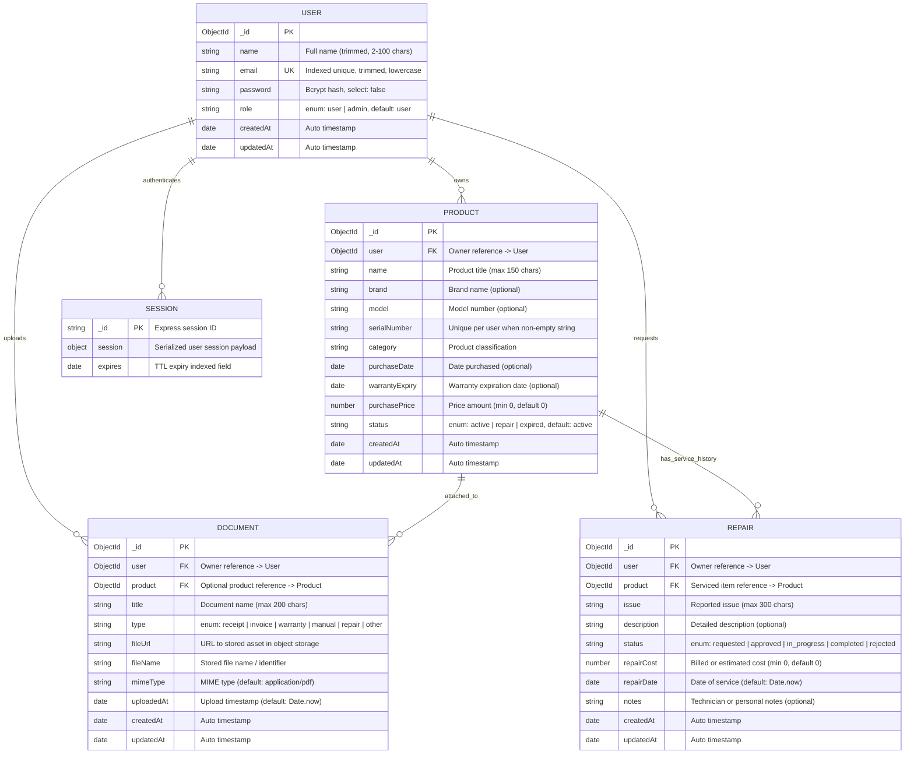

# ProofNest — Database Architecture & Specification Documentation

## 1. Overview & Technology Stack

| Component | Technology | Specification |
| :--- | :--- | :--- |
| **Database Engine** | MongoDB Atlas / Local MongoDB | MongoDB 6.0+ |
| **MongoDB Atlas Cluster** | `ProofNestCluster` | Existing cluster configuration (Target DB: `proofnest`) |
| **Target Database Name** | `proofnest` | Dedicated application database |
| **Existing Collections** | `users`, `products`, `documents`, `repairs` | Preserved without data loss or re-creation |
| **Object Data Modeling (ODM)** | Mongoose ODM | Mongoose 9.x |
| **Session Authentication Store**| `connect-mongo` + `express-session` | Session documents stored in `sessions` collection within `proofnest` |
| **Password Security** | `bcryptjs` | 10 salt rounds, pre-save hashing & comparison hooks |

> [!IMPORTANT]
> **Database Scope:** The cluster is **`ProofNestCluster`** and the target database is **`proofnest`**. Under no circumstances should another cluster or database be created, nor should existing collections or records be dropped.

---

## 2. Entity Relationship Diagram (Mermaid)



---

## 3. Collections & Schema Specifications

### 3.1 `users` Collection (`backend/models/User.js`)

Stores user identity, role, and credentials. Passwords are automatically hashed with `bcryptjs` and hidden from queries by default.

| Field Name | Type | Required? | Defaults / Constraints | Description |
| :--- | :--- | :---: | :--- | :--- |
| `_id` | `ObjectId` | Auto | Generated by MongoDB | Primary Key. |
| `name` | `String` | **Yes** | `trim: true`, min 2, max 100 chars | Display name of the user. |
| `email` | `String` | **Yes** | `unique: true`, `lowercase: true`, `trim: true`, Regex validation | Unique login identifier. |
| `password` | `String` | **Yes** | `select: false`, min 6 chars, bcrypt hash | Hashed password. Excluded from query results and serialization. |
| `role` | `String` | **Yes** | `enum: ['user', 'admin']`, default: `'user'` | Role tier. |
| `createdAt` | `Date` | Auto | `timestamps: true` | Record creation timestamp. |
| `updatedAt` | `Date` | Auto | `timestamps: true` | Record last modification timestamp. |

#### Methods & Hooks:
- **`pre('save')`**: Hashes `password` using `bcryptjs` (10 salt rounds) only when modified.
- **`comparePassword(candidatePassword)`**: Asynchronous instance method verifying plaintext candidate password against stored bcrypt hash (aliased as `matchPassword`).
- **`User.hashPassword(plainPassword)`**: Static utility method for explicit bcrypt hashing when direct query updates are used.
- **`toJSON` / `toObject` transforms**: Automatically deletes `password` and `__v` to prevent accidental credential leakage in API responses.

> [!WARNING]
> **Password Updates & Mongoose Middleware Bypass:**
> The `pre('save')` hook fires ONLY during document operations: `user.save()` or `User.create()`.
> Direct query updates (`User.findByIdAndUpdate()`, `User.updateOne()`, `User.updateMany()`) **BYPASS** document middleware and will store the password in plaintext if not pre-hashed.
> When updating passwords, backend developers must either:
> 1. **Document pattern (Recommended):** Fetch user document, set `user.password = newPassword`, and call `await user.save();` (triggers hook).
> 2. **Explicit hash pattern:** Manually hash via `const hashedPassword = await User.hashPassword(newPassword);` before passing to `findByIdAndUpdate()`.

---

### 3.2 `products` Collection (`backend/models/Product.js`)

Represents assets and personal property managed in ProofNest, including warranty and serial tracking.

| Field Name | Type | Required? | Defaults / Constraints | Description |
| :--- | :--- | :---: | :--- | :--- |
| `_id` | `ObjectId` | Auto | Generated by MongoDB | Primary Key. |
| `user` | `ObjectId` | **Yes** | `ref: 'User'` | Reference to the owning user. |
| `name` | `String` | **Yes** | `trim: true`, max 150 chars | Product title or item name. |
| `brand` | `String` | No | `trim: true`, default: `""` | Manufacturer or brand. |
| `model` | `String` | No | `trim: true`, default: `""` | Model identifier or number. |
| `serialNumber` | `String` | No | `trim: true`, default: `null` | Hardware serial number or VIN. |
| `category` | `String` | **Yes** | `trim: true` | Category (e.g., Electronics, Appliances, Tools). |
| `purchaseDate` | `Date` | No | Optional Date | Verified purchase date. |
| `warrantyExpiry` | `Date` | No | Optional Date | Manufacturer or extended warranty end date. |
| `purchasePrice` | `Number` | No | `min: 0`, default: `0` | Purchase cost. Cannot be negative. |
| `status` | `String` | **Yes** | `enum: ['active', 'repair', 'expired']`, default: `'active'` | Lifecycle status of the asset. |
| `createdAt` | `Date` | Auto | `timestamps: true` | Record creation timestamp. |
| `updatedAt` | `Date` | Auto | `timestamps: true` | Record last modification timestamp. |

#### Partial Unique Serial Number Index:
- **Definition:** `{ user: 1, serialNumber: 1 }` with `{ partialFilterExpression: { serialNumber: { $type: "string", $gt: "" } } }`.
- **How it works:**
  1. If `serialNumber` is a non-empty string (e.g. `"SN-12345"`), the unique index prevents the **same user** from creating a second product with the same serial number.
  2. If `serialNumber` is `null`, `""`, omitted, or whitespace (trimmed to `""`), MongoDB excludes the document from the unique index, allowing multiple items without serial numbers under the same user.
  3. Different users can register the same serial number without conflict.

---

### 3.3 `documents` Collection (`backend/models/Document.js`)

Stores metadata for receipts, invoices, manuals, and warranties. Binary payloads reside in object storage or the local upload directory.

| Field Name | Type | Required? | Defaults / Constraints | Description |
| :--- | :--- | :---: | :--- | :--- |
| `_id` | `ObjectId` | Auto | Generated by MongoDB | Primary Key. |
| `user` | `ObjectId` | **Yes** | `ref: 'User'` | Reference to the document owner. |
| `product` | `ObjectId` | No | `ref: 'Product'`, `index: true`, default: `null` | Optional reference linking document to a specific product. |
| `title` | `String` | **Yes** | `trim: true`, max 200 chars | Descriptive document title. |
| `type` | `String` | **Yes** | `enum: ['receipt', 'invoice', 'warranty', 'manual', 'repair', 'other']` | Classification of the document. |
| `fileUrl` | `String` | **Yes** | `trim: true` | Storage URL / path to the file. |
| `fileName` | `String` | **Yes** | `trim: true` | Stored file name. |
| `mimeType` | `String` | No | `trim: true`, default: `'application/pdf'` | MIME type. |
| `uploadedAt` | `Date` | **Yes** | default: `Date.now` | Timestamp of upload. |
| `createdAt` | `Date` | Auto | `timestamps: true` | Record creation timestamp. |
| `updatedAt` | `Date` | Auto | `timestamps: true` | Record last modification timestamp. |

---

### 3.4 `repairs` Collection (`backend/models/Repair.js`)

Maintains service records, warranty claims, and repair logs associated with products.

| Field Name | Type | Required? | Defaults / Constraints | Description |
| :--- | :--- | :---: | :--- | :--- |
| `_id` | `ObjectId` | Auto | Generated by MongoDB | Primary Key. |
| `user` | `ObjectId` | **Yes** | `ref: 'User'` | Reference to the ticket owner. |
| `product` | `ObjectId` | **Yes** | `ref: 'Product'` | Reference to the product undergoing service. |
| `issue` | `String` | **Yes** | `trim: true`, max 300 chars | Reported malfunction or maintenance request. |
| `description` | `String` | No | `trim: true`, default: `""` | Detailed notes regarding the repair. |
| `status` | `String` | **Yes** | `enum: ['requested', 'approved', 'in_progress', 'completed', 'rejected']`, default: `'requested'` | Progress status of the repair. |
| `repairCost` | `Number` | No | `min: 0`, default: `0` | Cost of repair. Cannot be negative. |
| `repairDate` | `Date` | No | default: `Date.now` | Service execution or completion date. |
| `notes` | `String` | No | `trim: true`, default: `""` | Internal technician or user notes. |
| `createdAt` | `Date` | Auto | `timestamps: true` | Record creation timestamp. |
| `updatedAt` | `Date` | Auto | `timestamps: true` | Record last modification timestamp. |

---

## 4. Database Indexes & Redundancy Elimination

### Index Optimization Strategy
In MongoDB, any compound index with `user: 1` as its leading key automatically satisfies single-field queries on `{ user: ObjectId }`. Declaring a standalone `{ user: 1 }` index alongside `{ user: 1, status: 1 }` or `{ user: 1, product: 1 }` is redundant and incurs unnecessary storage and write overhead.

| Collection | Active Index | Type | Status & Prefix Optimization |
| :--- | :--- | :--- | :--- |
| **`users`** | `{ email: 1 }` | Unique Index | Essential for unique login lookups. Single index. |
| **`products`** | `{ user: 1, serialNumber: 1 }` | Compound Partial Unique | Enforces serial uniqueness per user; non-redundant. |
| **`products`** | `{ user: 1, status: 1 }` | Compound Index | Also serves single-field queries on `user` (Standalone `{ user: 1 }` removed). |
| **`products`** | `{ user: 1, category: 1 }` | Compound Index | Categorized inventory queries. |
| **`products`** | `{ user: 1, warrantyExpiry: 1 }` | Compound Index | Upcoming warranty expiration lookups. |
| **`products`** | `{ user: 1, createdAt: -1 }` | Compound Index | Paginated product history sorting. |
| **`documents`** | `{ user: 1, product: 1 }` | Compound Index | Scoped queries for product documents (Standalone `{ user: 1 }` removed). |
| **`documents`** | `{ product: 1 }` | Single Index | Retained: allows direct lookup of documents attached to a product without user context. |
| **`documents`** | `{ user: 1, type: 1 }` | Compound Index | Filter documents by type for a user. |
| **`documents`** | `{ user: 1, uploadedAt: -1 }` | Compound Index | Chronological list of user uploads. |
| **`repairs`** | `{ user: 1, product: 1 }` | Compound Index | Scoped repair lookups (Standalone `{ user: 1 }` removed). |
| **`repairs`** | `{ user: 1, status: 1 }` | Compound Index | Filter user repair requests by status. |
| **`repairs`** | `{ product: 1, repairDate: -1 }` | Compound Index | Serves product repair history and single-field queries on `product` (Standalone `{ product: 1 }` removed). |
| **`sessions`** | `{ expires: 1 }` | Native TTL Index | Managed by MongoDB native background thread for expired sessions. |

---

## 5. Architectural Clarification: Ownership Consistency

> [!WARNING]
> **Crucial Rule for Backend Developers:**
> Mongoose `ref: 'User'` and `ref: 'Product'` are purely logical schema references and do **not** independently enforce ownership consistency.
>
> In MongoDB:
> - MongoDB does not validate that a `Product` referenced in a `Document` or `Repair` actually belongs to the user who uploaded the document or created the repair.
> - If User A submits a repair ticket with `user: UserA._id` and `product: ProductB._id` (owned by User B), MongoDB will accept the write.
>
> **Backend Service Responsibility:**
> Every controller or service handling documents or repairs MUST explicitly verify product ownership before saving:
> ```javascript
> const product = await Product.findById(req.body.productId);
> if (!product || !product.user.equals(req.session.userId)) {
>   return res.status(403).json({ error: "Access denied: You do not own this product." });
> }
> ```

---

## 6. Pre-Index Safety & Existing Data Audit

Before building or synchronizing unique indexes on existing MongoDB Atlas collections, the database layer provides a non-destructive audit utility in [`backend/config/checkIndexes.js`](file:///c:/Users/parth/Downloads/proofnest/ProofNest/backend/config/checkIndexes.js).

### Non-Destructive Invariant
- **Never deletes existing records.**
- Detects whether any duplicate `email` exists in `users` or duplicate `{ user, serialNumber }` exists in `products`.
- If duplicates exist, it logs an alert with conflicting document IDs and skips unique index synchronization to prevent collection locking or index build failures.

---

## 7. Session Storage Compatibility (`connect-mongo`)

ProofNest enforces **session-based authentication with HTTP-only cookies**. JWT is strictly omitted.

- **Store Module:** [`backend/config/sessionStore.js`](file:///c:/Users/parth/Downloads/proofnest/ProofNest/backend/config/sessionStore.js)
- **Target Database:** Strictly **`proofnest`** (does not create a secondary database).
- **Collection Name:** `sessions`
- **Session Expiration:** Default 14 days (TTL index handled natively by MongoDB).
- **Client Reuse:** Reuses the active Mongoose `MongoClient` instance to eliminate connection sprawl.

---

## 8. Backend Developer Integration Guide

### 8.1 Database Connection & Session Initialization

In your server bootstrap (`backend/server.js` or `backend/app.js`):

```javascript
const express = require("express");
const session = require("express-session");
const connectDB = require("./config/db");
const { createSessionStore } = require("./config/sessionStore");

const app = express();

// 1. Validate required environment variables — NO INSECURE FALLBACK
if (!process.env.SESSION_SECRET) {
  console.error("FATAL: SESSION_SECRET environment variable is missing.");
  process.exit(1);
}

// 2. Connect to existing MongoDB Atlas cluster 'ProofNestCluster' (database 'proofnest')
connectDB()
  .then(() => {
    // 3. Mount session middleware backed by connect-mongo in 'proofnest' database
    app.use(
      session({
        store: createSessionStore(),
        secret: process.env.SESSION_SECRET,
        resave: false,
        saveUninitialized: false,
        cookie: {
          httpOnly: true,
          secure: process.env.NODE_ENV === "production",
          maxAge: 14 * 24 * 60 * 60 * 1000, // 14 days
          sameSite: "lax",
        },
      })
    );

    app.listen(process.env.PORT || 4000, () => {
      console.log(`ProofNest API running on port ${process.env.PORT || 4000}`);
    });
  })
  .catch((err) => {
    console.error("Failed to connect to database:", err.message);
    process.exit(1);
  });
```

### 8.2 Importing Models

```javascript
// Centralized import:
const { User, Product, Document, Repair } = require("./models");

// Or individual import:
const User = require("./models/User");
const Product = require("./models/Product");
const Document = require("./models/Document");
const Repair = require("./models/Repair");
```

### 8.3 User Registration & Authentication Snippet

```javascript
// Registration: Password is automatically hashed by User.js pre-save hook
const user = await User.create({
  name: req.body.name,
  email: req.body.email,
  password: req.body.password,
});

// Login: Explicitly select '+password' because select: false is enabled on schema
const existingUser = await User.findOne({ email: req.body.email.toLowerCase() }).select("+password");

if (!existingUser) {
  return res.status(401).json({ error: "Invalid credentials" });
}

// Compare password using built-in bcrypt method
const isMatch = await existingUser.comparePassword(req.body.password);
if (!isMatch) {
  return res.status(401).json({ error: "Invalid credentials" });
}

// Store session identifier
req.session.userId = existingUser._id;
req.session.role = existingUser.role;

// Return sanitized user (password stripped automatically via toJSON transform)
res.json({ user: existingUser });

// Password Change Pattern 1 (Recommended - triggers pre('save') hook):
const userToUpdate = await User.findById(req.session.userId).select("+password");
userToUpdate.password = req.body.newPassword;
await userToUpdate.save(); // Automatically hashed via pre('save')

// Password Change Pattern 2 (Explicit hash for direct query updates):
const hashedNewPassword = await User.hashPassword(req.body.newPassword);
await User.findByIdAndUpdate(req.session.userId, { password: hashedNewPassword });
```

---

## 9. Automated Test Suite Execution & Live Results

The database-only test suite is located in [`backend/tests/database.test.js`](file:///c:/Users/parth/Downloads/proofnest/ProofNest/backend/tests/database.test.js).

### Running the Suite:
```bash
npm run test:db
```

### Verified Actual Results:
```text
===================================================================
  ProofNest Senior Database Engineer Verification Suite
===================================================================

[1/10] Verifying MongoDB Connection & Database Resolution...
[Database] MongoDB connected successfully: host=127.0.0.1, database=proofnest
  [PASS] Connection state is 1 (connected)
  [PASS] Active database is strictly 'proofnest' (expected 'proofnest')

[2/10] Running Pre-Index Safety Audit (Existing Data Inspection)...
[Database Audit] Inspecting existing collections for unique index conflicts...
[Database Audit] Zero duplicate conflicts detected. Safe to build unique indexes.
  [PASS] Safety audit ran non-destructively against existing collections without modifying data
  [PASS] Collection indexes synchronized successfully

[3/10] Verifying User Model, Validation & Password Hashing...
  [PASS] User required fields (name, email, password) enforced by schema
  [PASS] User role rejects values outside ['user', 'admin']
  [PASS] User created with valid ObjectId
  [PASS] User email automatically converted to lowercase
  [PASS] User password automatically hashed via bcryptjs with salt rounds
  [PASS] comparePassword returns true for correct plaintext password
  [PASS] comparePassword returns false for incorrect password
  [PASS] User password hash is omitted from JSON serialization

[4/10] Verifying Unique Email Index...
  [PASS] Duplicate email insertion correctly rejected by MongoDB unique index (code 11000)
  [PASS] User role 'admin' assigned and persisted

[5/10] Verifying Product Model & Required Fields...
  [PASS] Product required fields (user, name, category) enforced
  [PASS] Negative purchasePrice rejected by schema (min: 0)
  [PASS] Product status rejects values outside ['active', 'repair', 'expired']

[6/10] Thoroughly Verifying Partial Unique Serial Number Index...
  [PASS] Product with non-empty serial number created
  [PASS] Duplicate non-empty serial number under the SAME user is rejected by MongoDB unique partial index
  [PASS] Same serial number allowed across DIFFERENT users without conflict
  [PASS] Multiple products with null serial numbers allowed for the same user
  [PASS] Multiple products with empty string serial numbers allowed for the same user
  [PASS] Multiple products with omitted serial numbers allowed for the same user
  [PASS] Multiple products with whitespace serial numbers trimmed and allowed without collision

[7/10] Verifying & Demonstrating Ownership Consistency Behavior...
  [PASS] Mongoose schema validation passes on valid ObjectIds (confirming backend API must verify product.user === session.userId)

[8/10] Verifying Document Model & Metadata...
  [PASS] Document required fields (user, title, type, fileUrl, fileName) enforced
  [PASS] Document successfully linked to product ObjectId reference
  [PASS] Document product field is safely optional (null)

[9/10] Verifying Repair Model...
  [PASS] Repair required fields (user, product, issue) enforced
  [PASS] Negative repairCost rejected by schema (min: 0)
  [PASS] Repair created with valid references, status enum, and non-negative cost

[10/10] Verifying connect-mongo Session Store & Database Target...
  [PASS] Session store instance exposes set() method
  [PASS] Session store instance exposes get() method
  [PASS] Session store instance exposes destroy() method
  [PASS] Session payload successfully persisted and retrieved via connect-mongo
  [PASS] Session store targets database 'proofnest' and does NOT create a separate database

[Teardown] Safely cleaning up temporary test records...
  [PASS] Temporary test records cleaned up safely; zero production/existing data affected

===================================================================
  Verification Suite Complete: 37 Passed, 0 Failed
===================================================================
```
