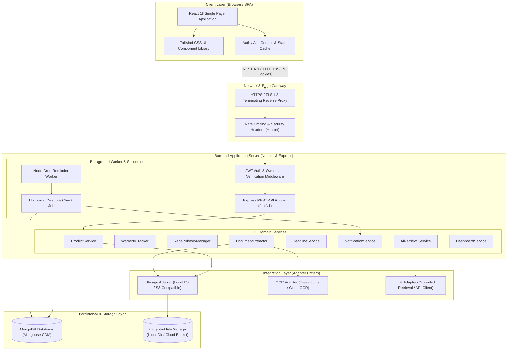
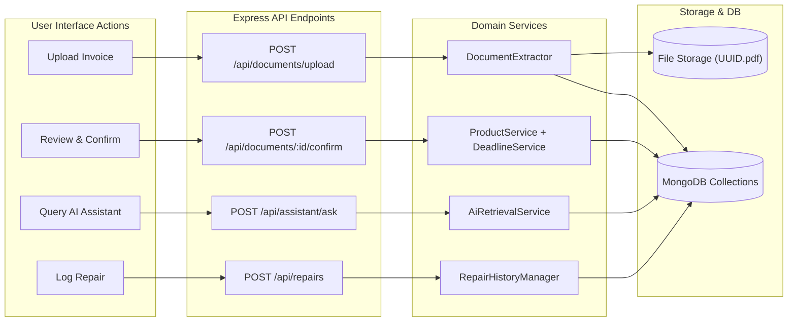

# ProofNest — System Architecture

---

## 1. High-Level Architecture Overview

ProofNest is built upon a decoupled, layered client-server architecture designed for high maintainability, strict security, and tenant isolation:

- **Client Layer:** React 18 Single Page Application (SPA) bundled with Vite and styled with Tailwind CSS. It communicates with the backend solely via HTTPS REST APIs using standard JSON payloads and multipart file uploads.
- **API & Application Gateway:** Express.js REST API providing rate limiting, security headers (Helmet), cookie parsing, JWT authentication, and request validation.
- **Domain Service Layer:** Object-Oriented service classes encapsulating business logic (`ProductService`, `WarrantyTracker`, `RepairHistoryManager`, `DocumentExtractor`, `DeadlineService`, `NotificationService`, `AiRetrievalService`, `DashboardService`).
- **Data Persistence Layer:** MongoDB document database accessed through Mongoose ODM, enforcing schemas, indexes, and relationship constraints.
- **Integration Layer:** Adapter interfaces abstracting physical file storage (local filesystem or cloud S3/R2), OCR document extraction engines, and LLM providers.
- **Background Worker:** A Node-cron scheduled runner executing deadline checks and in-app reminder dispatches.

---

## 2. High-Level Architectural Diagram

---

## 3. Subsystem Breakdown

### 3.1 Presentation Layer (Frontend)
- **Framework:** React 18 utilizing functional components with hooks.
- **Routing:** React Router v6 configuring public guest routes and protected authenticated routes.
- **Design & Styling:** Tailwind CSS providing utility-first responsive styling and consistent design tokens.
- **State Management:** Modular React Contexts (`AuthContext`, `ProductContext`, `NotificationContext`) combined with custom hooks for network calls and caching.
- **HTTP Client:** Axios / Fetch instance configured with `withCredentials: true` to automatically pass secure httpOnly cookies.

### 3.2 Gateway & Routing Layer (Backend)
- **Middleware Pipeline:**
  1. `cors()` configured to accept only the designated `FRONTEND_URL` with credentials allowed.
  2. `helmet()` setting secure HTTP headers (`X-Content-Type-Options`, `X-Frame-Options`, `Content-Security-Policy`).
  3. `express-rate-limit` protecting authentication endpoints against brute force and AI endpoints against abuse.
  4. `cookieParser()` parsing encrypted authentication cookies.
  5. `authenticateToken` middleware verifying JWT signatures and attaching `req.user` (`{ id, email }`).
  6. Express JSON body parser with strict 2 MB payload limits for non-upload endpoints.
  7. Multer middleware configured for multipart/form-data upload validation (10 MB cap, MIME filter).

### 3.3 Domain Service Layer (OOP Architecture)
Business logic is strictly decoupled from Express request/response handlers. Controllers validate HTTP inputs and delegate business workflows to specialized singleton service classes:
- `ProductService`: Coordinates product lifecycle, search filtering, category aggregation, and history construction.
- `WarrantyTracker`: Manages warranty status evaluation, countdown calculation, and warranty-deadline synchronization.
- `RepairHistoryManager`: Handles repair entries and calculates dynamic expenditure sums.
- `DocumentExtractor`: Coordinates file persistence, triggers OCR adapters, stores normalized suggestions, and executes the confirmation workflow.
- `DeadlineService`: Manages deadline states and overdue evaluations.
- `NotificationService`: Creates in-app alerts and dispatches transactional emails.
- `AiRetrievalService`: Handles intent classification, context retrieval from MongoDB, prompt assembly, and citation mapping.
- `DashboardService`: Aggregates summary statistics for rapid dashboard rendering.

### 3.4 Integration & Storage Layer
ProofNest adheres to the **Adapter Pattern** for all external dependencies:
- **Storage Adapter (`StorageService`):** Supports `LocalStorageAdapter` for zero-dependency local development and `S3StorageAdapter` for production cloud storage (AWS S3, Cloudflare R2, MinIO).
- **OCR Engine Adapter (`OcrService`):** Supports `TesseractOcrAdapter` for offline testing and cloud adapters (Google Cloud Document AI, AWS Textract) for production.
- **LLM Adapter (`LlmService`):** Provides a standardized interface for sending grounded prompts and receiving structured answers across OpenAI, Anthropic, or local open-source LLMs.

---

## 4. Complete Data Flow Diagram

---

## 5. Security & Isolation Invariants

The architecture enforces three architectural invariants that cannot be bypassed:
1. **The Tenant Invariant:** Every query to MongoDB must include `{ userId: req.user.id }`. No global `findById` calls are permitted without checking owner equality.
2. **The Verification Invariant:** Data extracted from documents must remain in `review_required` status until verified via `POST /api/documents/:id/confirm`. Unconfirmed OCR values are never promoted to verified product records.
3. **The Grounding Invariant:** The AI assistant must only receive context documents that have passed user-scoped authorization queries. The system prompt strictly prohibits speculation or invention of missing data.

