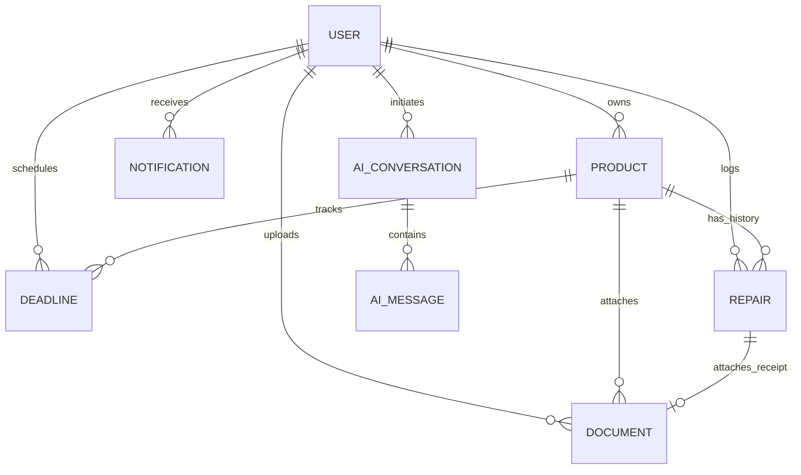

# ProofNest — Database Design & Data Models

---

## 1. Database Architecture & Technology

ProofNest uses **MongoDB** as its primary persistence engine, accessed through **Mongoose ODM** (Object Document Mapper). 

### Key Principles:
1. **Strong Typing & Schema Enforcement:** Even though MongoDB is schemaless, Mongoose models enforce field validation, required constraints, and default values.
2. **Referential Integrity via ObjectIds:** Relational links between entities use standard 12-byte BSON `ObjectId` references (`ref: 'Product'`, `ref: 'User'`).
3. **Strict Scoping by `userId`:** Every collection (except `User` itself) contains a required `userId` field indexed for fast tenant-isolated queries.
4. **Calculated Aggregations Over Denormalized Counters:** Financial totals (such as total repair costs) are computed dynamically using MongoDB aggregation pipelines rather than maintaining error-prone mutable running totals.

---

## 2. Entity Relationship Diagram



---

## 3. Collections & Mongoose Schema Specifications

### 3.1 `User` Collection

#### Purpose
Stores user authentication credentials, display profile details, preferred currency, and notification settings.

#### Mongoose Schema Specification
```javascript
const userSchema = new mongoose.Schema({
  email: {
    type: String,
    required: [true, 'Email is required'],
    unique: true,
    lowercase: true,
    trim: true,
    match: [/^\S+@\S+\.\S+$/, 'Invalid email address format']
  },
  passwordHash: {
    type: String,
    required: [true, 'Password hash is required'],
    minlength: 60 // standard bcrypt hash length
  },
  fullName: {
    type: String,
    required: [true, 'Full name is required'],
    trim: true,
    maxlength: 100
  },
  preferredCurrency: {
    type: String,
    default: 'USD',
    uppercase: true,
    minlength: 3,
    maxlength: 3
  },
  notificationPreferences: {
    emailAlerts: { type: Boolean, default: false },
    inAppAlerts: { type: Boolean, default: true },
    reminderDays: { type: [Number], default: [30, 7, 1] }
  }
}, {
  timestamps: true
});

userSchema.index({ email: 1 });
```

#### Sample Document JSON
```json
{
  "_id": "65a000000000000000000001",
  "email": "marcus.dev@example.com",
  "passwordHash": "$2b$12$e8Y6bFvA9fKj1lM2n3o4p.uVwXyZaBcDeFgHiJkLmNoPqRsTuVwXy",
  "fullName": "Marcus Vance",
  "preferredCurrency": "USD",
  "notificationPreferences": {
    "emailAlerts": false,
    "inAppAlerts": true,
    "reminderDays": [30, 7, 1]
  },
  "createdAt": "2026-01-15T10:00:00.000Z",
  "updatedAt": "2026-01-15T10:00:00.000Z"
}
```

---

### 3.2 `Product` Collection

#### Purpose
Maintains the personal asset inventory for all purchased items.

#### Mongoose Schema Specification
```javascript
const productSchema = new mongoose.Schema({
  userId: {
    type: mongoose.Schema.Types.ObjectId,
    ref: 'User',
    required: true,
    index: true
  },
  name: {
    type: String,
    required: [true, 'Product name is required'],
    trim: true,
    maxlength: 120
  },
  brand: {
    type: String,
    required: [true, 'Brand is required'],
    trim: true,
    maxlength: 60,
    index: true
  },
  category: {
    type: String,
    required: true,
    enum: [
      'Electronics',
      'Appliances',
      'Home & Furniture',
      'Tools & Garden',
      'Automotive',
      'Personal & Wearables',
      'Other'
    ],
    default: 'Other',
    index: true
  },
  model: {
    type: String,
    trim: true,
    maxlength: 80
  },
  serialNumber: {
    type: String,
    trim: true,
    maxlength: 100
  },
  purchaseDate: {
    type: Date,
    required: [true, 'Purchase date is required']
  },
  purchasePrice: {
    type: Number,
    required: [true, 'Purchase price is required'],
    min: [0, 'Purchase price cannot be negative']
  },
  currency: {
    type: String,
    required: true,
    default: 'USD',
    uppercase: true,
    minlength: 3,
    maxlength: 3
  },
  retailer: {
    type: String,
    trim: true,
    maxlength: 80
  },
  description: {
    type: String,
    trim: true,
    maxlength: 1000
  },
  imageUrl: {
    type: String,
    trim: true
  },
  warrantyStartDate: {
    type: Date
  },
  warrantyExpiryDate: {
    type: Date,
    index: true
  },
  returnDeadline: {
    type: Date,
    index: true
  },
  status: {
    type: String,
    enum: ['active', 'retired', 'disposed', 'returned'],
    default: 'active',
    index: true
  }
}, {
  timestamps: true
});

// Compound indexes for user-scoped filtering, sorting, and search
productSchema.index({ userId: 1, createdAt: -1 });
productSchema.index({ userId: 1, category: 1 });
productSchema.index({ userId: 1, brand: 1 });
productSchema.index({ userId: 1, warrantyExpiryDate: 1 });
productSchema.index({ name: 'text', brand: 'text', model: 'text', description: 'text' });
```

#### Sample Document JSON
```json
{
  "_id": "65a111111111111111111111",
  "userId": "65a000000000000000000001",
  "name": "MacBook Pro 16\"",
  "brand": "Apple",
  "category": "Electronics",
  "model": "A2485 M1 Max",
  "serialNumber": "C02G1234MD6R",
  "purchaseDate": "2025-11-20T00:00:00.000Z",
  "purchasePrice": 3499.00,
  "currency": "USD",
  "retailer": "Apple Fifth Avenue",
  "description": "Space Gray, 32-core GPU, 64GB Unified Memory, 2TB SSD",
  "imageUrl": "/uploads/products/macbook-pro.jpg",
  "warrantyStartDate": "2025-11-20T00:00:00.000Z",
  "warrantyExpiryDate": "2028-11-20T00:00:00.000Z",
  "returnDeadline": "2025-12-04T00:00:00.000Z",
  "status": "active",
  "createdAt": "2025-11-21T08:30:00.000Z",
  "updatedAt": "2025-11-21T08:30:00.000Z"
}
```

---

### 3.3 `Document` Collection

#### Purpose
Stores uploaded invoices, warranties, manuals, and receipts along with extraction suggestions and confirmation metadata.

#### Mongoose Schema Specification
```javascript
const documentSchema = new mongoose.Schema({
  userId: {
    type: mongoose.Schema.Types.ObjectId,
    ref: 'User',
    required: true,
    index: true
  },
  productId: {
    type: mongoose.Schema.Types.ObjectId,
    ref: 'Product',
    default: null,
    index: true
  },
  fileName: {
    type: String,
    required: true // UUID filename on disk/bucket
  },
  originalName: {
    type: String,
    required: true // original file upload name
  },
  fileType: {
    type: String,
    enum: ['invoice', 'warranty', 'manual', 'receipt', 'service', 'other'],
    default: 'other',
    required: true
  },
  mimeType: {
    type: String,
    required: true
  },
  fileSize: {
    type: Number,
    required: true,
    max: 10485760 // 10 MB limit in bytes
  },
  storageKey: {
    type: String,
    required: true
  },
  extractionStatus: {
    type: String,
    enum: ['pending', 'processing', 'review_required', 'confirmed', 'failed'],
    default: 'pending',
    index: true
  },
  rawOcrData: {
    type: mongoose.Schema.Types.Mixed,
    default: null
  },
  suggestedFields: {
    merchant: { type: String, default: null },
    date: { type: Date, default: null },
    totalAmount: { type: Number, default: null },
    currency: { type: String, default: null },
    itemName: { type: String, default: null },
    brand: { type: String, default: null },
    model: { type: String, default: null },
    serialNumber: { type: String, default: null },
    warrantyPeriodMonths: { type: Number, default: null }
  },
  confirmedAt: {
    type: Date,
    default: null
  }
}, {
  timestamps: true
});

documentSchema.index({ userId: 1, createdAt: -1 });
documentSchema.index({ userId: 1, productId: 1 });
documentSchema.index({ userId: 1, extractionStatus: 1 });
```

#### Sample Document JSON
```json
{
  "_id": "65b222222222222222222222",
  "userId": "65a000000000000000000001",
  "productId": "65a111111111111111111111",
  "fileName": "a4d3f2e1-88c9-4b31-92f7-ec8219482910.pdf",
  "originalName": "Apple_Store_Invoice_1092831.pdf",
  "fileType": "invoice",
  "mimeType": "application/pdf",
  "fileSize": 248910,
  "storageKey": "uploads/documents/2026/01/a4d3f2e1-88c9-4b31-92f7-ec8219482910.pdf",
  "extractionStatus": "confirmed",
  "suggestedFields": {
    "merchant": "Apple Fifth Avenue",
    "date": "2025-11-20T00:00:00.000Z",
    "totalAmount": 3499.00,
    "currency": "USD",
    "itemName": "MacBook Pro 16",
    "brand": "Apple",
    "model": "A2485",
    "serialNumber": "C02G1234MD6R",
    "warrantyPeriodMonths": 36
  },
  "confirmedAt": "2025-11-21T08:30:00.000Z",
  "createdAt": "2025-11-21T08:25:00.000Z",
  "updatedAt": "2025-11-21T08:30:00.000Z"
}
```

---

### 3.4 `Deadline` Collection

#### Purpose
Stores actionable calendar dates (warranties, return deadlines, service schedules) with notification thresholds.

#### Mongoose Schema Specification
```javascript
const deadlineSchema = new mongoose.Schema({
  userId: {
    type: mongoose.Schema.Types.ObjectId,
    ref: 'User',
    required: true,
    index: true
  },
  productId: {
    type: mongoose.Schema.Types.ObjectId,
    ref: 'Product',
    required: true,
    index: true
  },
  title: {
    type: String,
    required: [true, 'Deadline title is required'],
    trim: true,
    maxlength: 120
  },
  deadlineType: {
    type: String,
    enum: ['warranty_expiry', 'return_window', 'maintenance', 'custom'],
    required: true,
    index: true
  },
  dueDate: {
    type: Date,
    required: [true, 'Due date is required'],
    index: true
  },
  reminderDaysBefore: {
    type: [Number],
    default: [30, 7, 1]
  },
  status: {
    type: String,
    enum: ['pending', 'completed', 'dismissed', 'overdue'],
    default: 'pending',
    index: true
  },
  source: {
    type: String,
    enum: ['manual', 'confirmed_extraction'],
    default: 'manual'
  },
  isConfirmed: {
    type: Boolean,
    default: true
  },
  lastNotifiedAt: {
    type: Date,
    default: null
  }
}, {
  timestamps: true
});

deadlineSchema.index({ userId: 1, dueDate: 1, status: 1 });
deadlineSchema.index({ userId: 1, productId: 1 });
```

#### Sample Document JSON
```json
{
  "_id": "65c333333333333333333333",
  "userId": "65a000000000000000000001",
  "productId": "65a111111111111111111111",
  "title": "AppleCare+ Warranty Expiry",
  "deadlineType": "warranty_expiry",
  "dueDate": "2028-11-20T00:00:00.000Z",
  "reminderDaysBefore": [30, 7, 1],
  "status": "pending",
  "source": "confirmed_extraction",
  "isConfirmed": true,
  "lastNotifiedAt": null,
  "createdAt": "2025-11-21T08:30:00.000Z",
  "updatedAt": "2025-11-21T08:30:00.000Z"
}
```

---

### 3.5 `Repair` Collection

#### Purpose
Maintains individual service logs and repair expenses for each product.

#### Mongoose Schema Specification
```javascript
const repairSchema = new mongoose.Schema({
  userId: {
    type: mongoose.Schema.Types.ObjectId,
    ref: 'User',
    required: true,
    index: true
  },
  productId: {
    type: mongoose.Schema.Types.ObjectId,
    ref: 'Product',
    required: true,
    index: true
  },
  repairDate: {
    type: Date,
    required: [true, 'Repair date is required'],
    index: true
  },
  serviceCenter: {
    type: String,
    required: [true, 'Service center name is required'],
    trim: true,
    maxlength: 100
  },
  issueDescription: {
    type: String,
    required: [true, 'Issue description is required'],
    trim: true,
    maxlength: 1000
  },
  workPerformed: {
    type: String,
    trim: true,
    maxlength: 1000
  },
  cost: {
    type: Number,
    required: [true, 'Repair cost is required'],
    min: [0, 'Cost cannot be negative'],
    default: 0
  },
  currency: {
    type: String,
    required: true,
    default: 'USD',
    uppercase: true,
    minlength: 3,
    maxlength: 3
  },
  status: {
    type: String,
    enum: ['completed', 'in_progress', 'pending'],
    default: 'completed'
  },
  documentId: {
    type: mongoose.Schema.Types.ObjectId,
    ref: 'Document',
    default: null
  }
}, {
  timestamps: true
});

repairSchema.index({ userId: 1, productId: 1, repairDate: -1 });
```

#### Sample Document JSON
```json
{
  "_id": "65d444444444444444444444",
  "userId": "65a000000000000000000001",
  "productId": "65a111111111111111111111",
  "repairDate": "2026-06-14T00:00:00.000Z",
  "serviceCenter": "Apple Authorized Service Provider - SoHo",
  "issueDescription": "Key 'B' and spacebar sticking intermittently.",
  "workPerformed": "Replaced top case assembly with battery under manufacturer warranty.",
  "cost": 0.00,
  "currency": "USD",
  "status": "completed",
  "documentId": "65b222222222222222222223",
  "createdAt": "2026-06-15T14:10:00.000Z",
  "updatedAt": "2026-06-15T14:10:00.000Z"
}
```

---

### 3.6 `Notification` Collection

#### Purpose
Stores actionable alerts and deadline reminders for the authenticated user.

#### Mongoose Schema Specification
```javascript
const notificationSchema = new mongoose.Schema({
  userId: {
    type: mongoose.Schema.Types.ObjectId,
    ref: 'User',
    required: true,
    index: true
  },
  deadlineId: {
    type: mongoose.Schema.Types.ObjectId,
    ref: 'Deadline',
    default: null
  },
  productId: {
    type: mongoose.Schema.Types.ObjectId,
    ref: 'Product',
    default: null
  },
  type: {
    type: String,
    enum: ['deadline_reminder', 'warranty_warning', 'extraction_ready', 'system'],
    required: true
  },
  title: {
    type: String,
    required: true,
    maxlength: 120
  },
  message: {
    type: String,
    required: true,
    maxlength: 500
  },
  isRead: {
    type: Boolean,
    default: false,
    index: true
  },
  readAt: {
    type: Date,
    default: null
  }
}, {
  timestamps: true
});

notificationSchema.index({ userId: 1, isRead: 1, createdAt: -1 });
```

---

### 3.7 `AiConversation` & `AiMessage` Collections

#### Purpose
Maintains session history and message tracking for the grounded AI Product Assistant.

#### Mongoose Schema Specification
```javascript
const aiConversationSchema = new mongoose.Schema({
  userId: {
    type: mongoose.Schema.Types.ObjectId,
    ref: 'User',
    required: true,
    index: true
  },
  title: {
    type: String,
    default: 'New Consultation',
    maxlength: 100
  }
}, {
  timestamps: true
});

const aiMessageSchema = new mongoose.Schema({
  conversationId: {
    type: mongoose.Schema.Types.ObjectId,
    ref: 'AiConversation',
    required: true,
    index: true
  },
  role: {
    type: String,
    enum: ['user', 'assistant', 'system'],
    required: true
  },
  content: {
    type: String,
    required: true
  },
  citedProductIds: [{
    type: mongoose.Schema.Types.ObjectId,
    ref: 'Product'
  }],
  citedDocumentIds: [{
    type: mongoose.Schema.Types.ObjectId,
    ref: 'Document'
  }]
}, {
  timestamps: true
});
```

---

## 4. Deletion Cascade & Data Purging Rules

```
                      +-------------------+
                      |      DELETE       |
                      |  /api/products/:id|
                      +---------+---------+
                                |
             +------------------+------------------+
             |                                     |
             v                                     v
   +--------------------+                +--------------------+
   |   Purge Associated |                |   Purge Associated |
   |      Deadlines     |                |       Repairs      |
   +--------------------+                +--------------------+
             |                                     |
             +------------------+------------------+
                                |
                                v
             +-------------------------------------+
             | Document Policy Decision:           |
             |  - Default: Unlink productId        |
             |    (retains invoice in user's vault)|
             |  - If ?deleteFiles=true:            |
             |    1. Remove Document records       |
             |    2. Call StorageAdapter.deleteFile|
             +-------------------------------------+
```

1. **Deadlines & Repairs:** Always hard deleted upon product deletion because they have no meaning outside the product context.
2. **Documents:** By default, their `productId` is set to `null` to retain valuable tax/insurance receipts in the user's document vault. If the client passes `?deleteFiles=true`, the documents and their physical files are permanently deleted.
