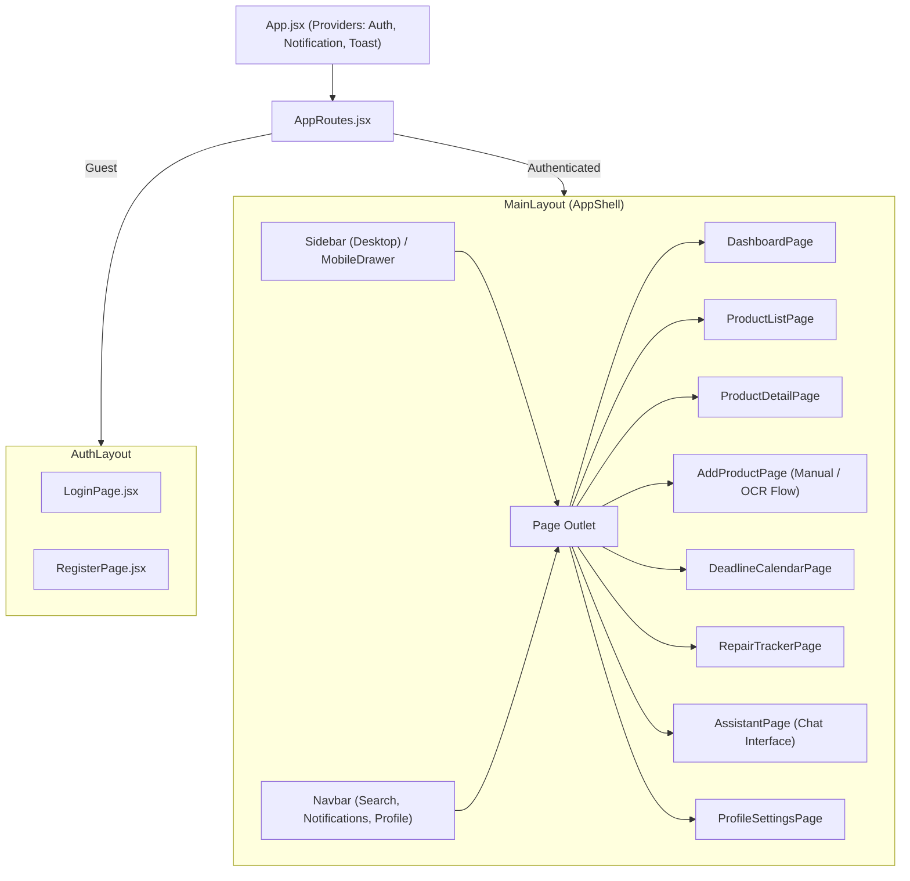

# ProofNest — Frontend Architecture & UI Blueprint

---

## 1. Frontend Technology Stack & Design Philosophy

- **Framework:** React 18+ (Single Page Application)
- **Build Tool:** Vite (fast ESM HMR and optimized production bundling)
- **Styling:** Tailwind CSS (utility-first styling with design system tokens)
- **Routing:** React Router v6+ (declarative nested routes with protected route guards)
- **Icons:** Lucide React (clean, consistent SVG iconography)
- **HTTP Client:** Axios with centralized interceptors for cookie credentials and error translation.

### Philosophy: Consumer Utility over Corporate Complexity
ProofNest must feel like a modern, calm, reliable personal management app (inspired by apps like Linear, Notion, and Things 3). It is **not** an e-commerce catalog or an IT ticketing tool. High readability, responsive mobile navigation, and clear visual cues for unconfirmed OCR states are essential.

---

## 2. Directory Structure (`frontend/src/`)

```text
frontend/src/
|-- assets/               # Logos, empty state SVGs, brand badges
|-- components/
|   |-- common/           # Atoms & molecules (Buttons, Badges, Inputs, Modals, Loaders)
|   |-- layout/           # Navbar, Sidebar, AppShell, Footer, Breadcrumbs
|   |-- dashboard/        # StatCard, RecentProductsCard, UpcomingDeadlinesCard
|   |-- products/         # ProductCard, ProductTable, ProductFilter, ProductTimeline
|   |-- documents/        # DocumentCard, DocumentDropzone, ExtractionReviewModal
|   |-- deadlines/        # CalendarGrid, DeadlineItem, AddDeadlineModal
|   |-- repairs/          # RepairList, RepairCostSummary, AddRepairModal
|   |-- assistant/        # ChatWindow, MessageBubble, CitationPill, ExamplePrompts
|-- context/              # AuthContext, NotificationContext, ThemeContext
|-- hooks/                # useAuth, useProducts, useDeadlines, useDocuments, useAssistant
|-- layouts/              # MainLayout (with sidebar/nav) & AuthLayout (centered card)
|-- pages/
|   |-- auth/             # LoginPage, RegisterPage
|   |-- dashboard/        # DashboardPage
|   |-- products/         # ProductListPage, ProductDetailPage, AddProductPage, EditProductPage
|   |-- documents/        # DocumentVaultPage
|   |-- deadlines/        # DeadlineCalendarPage
|   |-- repairs/          # RepairTrackerPage
|   |-- assistant/        # AssistantPage
|   |-- settings/         # ProfileSettingsPage
|   |-- NotFoundPage.jsx  # 404 handler
|-- routes/               # AppRoutes.jsx, ProtectedRoute.jsx, PublicRoute.jsx
|-- services/             # api.js, authService.js, productService.js, etc.
|-- utils/                # dateUtils.js, currencyFormatter.js, validators.js
|-- constants/            # categories.js, deadlineTypes.js, navItems.js
|-- styles/               # index.css (Tailwind base, components, utilities)
|-- App.jsx               # Application root with context providers and route tree
|-- main.jsx              # DOM entry point
```

---

## 3. Component Hierarchy & Layout Tree



---

## 4. Key Page Specifications

### 4.1 Dashboard (`/dashboard`)
- **Metric Cards:**
  - Total Registered Products
  - Expiring Warranties (Next 30 Days) with urgency badge (yellow/red)
  - Active Return Windows with countdown days
  - Lifetime Repair Spend (summarized by currency)
- **Quick Action Bar:** "Add Product", "Upload Invoice", "Ask Assistant".
- **Split View:**
  - Left: Recently added products with thumbnail, purchase date, and price.
  - Right: Upcoming deadline agenda list with direct "Mark Completed" buttons.

### 4.2 Product Inventory (`/products`)
- **Controls:** Unified search input (queries name, brand, model, serial), category chips (All, Electronics, Appliances, etc.), brand dropdown, and sort selector (`Newest`, `Price: High-to-Low`, `Warranty Expiry`).
- **View Toggle:** Switch between responsive Grid Cards and dense Table view.
- **Card Content:** Product photo thumbnail, name, brand, purchase date, purchase price, and warranty status pill (`Active - 2 yrs left`, `Expiring Soon`, `Expired`).

### 4.3 Product Detail Page (`/products/:id`)
- **Header:** Product title, brand, category tag, serial number, and "Edit" / "Delete" actions.
- **Tabs:**
  1. **Overview:** Technical specifications, purchase retailer, price, description.
  2. **Documents (Vault):** Attached invoices, warranties, and manuals with inline previews and secure download buttons.
  3. **Deadlines & Warranties:** Visual countdown bar showing warranty progression from purchase to expiry; return window status.
  4. **Repair History:** Chronological log of service visits, cost breakdown, and dynamic total spent badge.
  5. **Timeline:** Unified historical feed showing date of purchase, warranty registration, service events, and attached receipts.

### 4.4 Add Product & Invoice OCR Review (`/products/new`)
- **Dual Intake Modes:**
  - **Mode A: Manual Entry:** Standard multi-section form with real-time validation.
  - **Mode B: Scan & Extract Invoice:** Drag-and-drop zone for PDF/image receipts.
- **Extraction Review Modal:**
  - Split screen: Left side shows high-resolution rendered PDF or receipt image; Right side shows extracted form fields with confidence indicators.
  - Editable fields allow the user to fix any OCR discrepancies.
  - Bottom actions: "Cancel" (discards extraction) vs "Confirm & Save Product" (commits verified records).

### 4.5 AI Product Assistant (`/assistant`)
- **Chat Interface:** WhatsApp/ChatGPT-style message stream.
- **Suggested Prompts Carousel:** One-click chips like:
  - *"Which warranties expire this month?"*
  - *"How much have I spent on repairs total?"*
  - *"Show me the invoice for my phone."*
- **Assistant Message Card:** Formatted markdown answer with embedded **Citation Badges** (`[Apple MacBook Pro 16"]`, `[Receipt #892]`). Clicking a badge opens the corresponding product or document in a preview slideover.

---

## 5. State Management & Data Fetching

### 5.1 Context Boundaries
- `AuthContext`: Holds current user state (`id`, `email`, `fullName`, `preferredCurrency`), `login()`, `logout()`, `register()`, and token refresh handlers.
- `NotificationContext`: Manages unread alert counts, polling interval (or SSE listener), and `markAsRead()` actions.

### 5.2 Custom Data Hooks
To encapsulate API logic and caching, frontend components rely on custom hooks:
- `useProducts({ category, search, sort, page })`: Manages fetch lifecycle, loading states, and error handling for product inventory.
- `useProduct(id)`: Fetches single product along with attached documents and repair aggregates.
- `useDeadlines({ view: 'calendar' | 'list', month, year })`: Manages deadline events.
- `useAssistant()`: Manages message history, query submission, loading/streaming states, and citations.

---

## 6. Design System Tokens (Tailwind CSS)

```javascript
// tailwind.config.js snippet
module.exports = {
  theme: {
    extend: {
      colors: {
        brand: {
          50: '#f0f7ff',
          100: '#e0effe',
          500: '#0284c7', // Primary Ocean Blue
          600: '#0369a1',
          700: '#075985',
        },
        slate: {
          850: '#151f32', // Dark card surfaces
          900: '#0f172a', // Deep background
        },
        success: '#10b981',
        warning: '#f59e0b',
        danger: '#ef4444'
      },
      fontFamily: {
        sans: ['Inter', 'system-ui', 'sans-serif'],
        mono: ['JetBrains Mono', 'monospace']
      }
    }
  }
}
```
