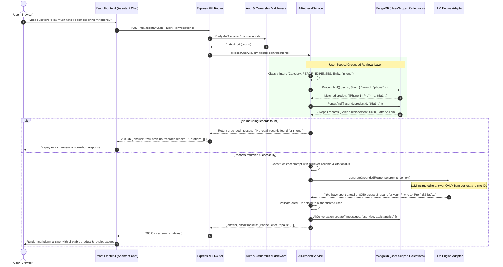

# ProofNest — AI Assistant Architecture & Retrieval Design

---

## 1. Objective & Non-Negotiable AI Principles

The ProofNest AI Assistant is designed to answer natural language questions about the user's personal inventory, invoices, warranties, deadlines, and repair history.

Because personal financial and warranty records directly impact consumer legal and warranty rights, the AI system adheres to three strict principles:

```
+-----------------------------------------------------------------------------------------+
|                                THREE CORE AI PRINCIPLES                                 |
+-----------------------------------------------------------------------------------------+
| 1. ZERO SPECULATION (STRICT GROUNDING):                                                 |
|    Answers must be grounded 100% in the user's retrieved records. The assistant must    |
|    never fabricate purchase dates, warranty periods, or repair expenses.                |
|                                                                                         |
| 2. USER TENANT ISOLATION:                                                               |
|    The retrieval pipeline must NEVER access records belonging to another user.          |
|    Every query has { userId: req.user.id } immutably injected at the database query.    |
|                                                                                         |
| 3. MANDATORY CITATION & ABSENCE REPORTING:                                              |
|    Every statement regarding a product must cite the corresponding record ID. If an    |
|    item or receipt is not found, the assistant must explicitly say it is unavailable.   |
+-----------------------------------------------------------------------------------------+
```

---

## 2. End-to-End AI Workflow Sequence



---

## 3. Technology Evaluation: MongoDB Search vs. Dedicated Vector DB

A core architectural question for ProofNest is whether to introduce a dedicated external vector database (e.g. Pinecone, Chroma, Qdrant) in the MVP or leverage MongoDB's native indexing capabilities.

### Comparative Architectural Analysis

| Criteria | Approach A: MongoDB Text & Compound Indexes (Selected for MVP) | Approach B: Dedicated Vector DB (Pinecone/Chroma) |
| :--- | :--- | :--- |
| **Operational Complexity** | **Zero added infrastructure.** Reuses existing MongoDB cluster. | High. Requires managing an external SaaS or self-hosted vector database. |
| **Tenant Isolation & Security**| **Native & mathematically guaranteed.** Enforced directly in Mongoose query `{ userId: req.user.id }`. | Complex. Requires strict metadata filtering and synchronizing tenant partitions in vector space. |
| **Data Consistency & Staleness**| **Real-time ACID consistency.** When a product is updated or deleted, search reflects changes immediately. | Delayed. Requires CDC (Change Data Capture) or webhook synchronization pipeline. |
| **Cost** | **$0 extra.** Runs on existing database instance. | Added monthly SaaS fees or memory-intensive self-hosted containers. |
| **Suitability for Query Types**| **Optimal for MVP queries:** "Which warranties expire next month?", "Show laptop invoice", "How much spent on phone repairs?" | Overkill for structured date, cost, and name queries; better suited for semantic manual search. |

### Technical Decision (ADR-005)
**For the MVP phase, ProofNest will use MongoDB compound queries and text indexing.** A dedicated vector database introduces unnecessary operational overhead and potential data-sync drift without adding value for structured metadata queries. Dedicated vector embeddings for semantic document manual search are deferred to Post-MVP (Phase 10+).

---

## 4. Query Intent Classification & Routing

When a question arrives at `AiRetrievalService.processQuery()`, a lightweight parser classifies the intent into one of five categories:

1. **WARRANTY_EXPIRY_QUERY:** (e.g. *"Which warranties expire next month?"*)
   - Handler queries `Deadline.find({ userId, deadlineType: 'warranty_expiry', dueDate: { $gte, $lte } })` populated with `Product`.
2. **REPAIR_EXPENSES_QUERY:** (e.g. *"How much did I spend repairing my laptop?"*)
   - Handler queries `Product.find({ userId, $text: { $search: keyword } })`, then executes dynamic repair aggregation on matching products.
3. **DOCUMENT_SEARCH_QUERY:** (e.g. *"Find my TV manual"*, *"Show me my refrigerator invoice"*)
   - Handler queries `Product` and `Document` collections matching `userId` and document type.
4. **PURCHASE_INFO_QUERY:** (e.g. *"When did I buy my washer?"*, *"What was the purchase price of my monitor?"*)
   - Handler queries `Product.findOne({ userId, $text: { $search: keyword } })`.
5. **GENERAL_INVENTORY_QUERY:** (e.g. *"List all my Sony electronics"*, *"How many active products do I have?"*)
   - Handler executes aggregated inventory queries.

---

## 5. Grounded Prompt Template Design

The prompt template injected into the LLM adapter guarantees strict adherence to facts:

```text
SYSTEM PROMPT:
You are the ProofNest AI Assistant, a reliable assistant that answers questions about the user's purchased products, warranties, repair logs, and invoices.

RULES:
1. You must answer the user's question using ONLY the verified records provided in the [USER_RECORDS] section below.
2. DO NOT speculate, assume, or fabricate any dates, prices, warranty periods, or service details.
3. When referencing a product, include its citation tag: [Product: <PRODUCT_ID>].
4. When referencing a document or invoice, include its citation tag: [Doc: <DOCUMENT_ID>].
5. When referencing a repair, include its citation tag: [Repair: <REPAIR_ID>].
6. If the user's question asks for information not present in the [USER_RECORDS], state clearly:
   "I checked your ProofNest records, but could not find information regarding [topic]. Would you like to add this product or upload a document?"
7. Be concise, friendly, and accurate.

[USER_RECORDS]
{{USER_RECORDS_JSON}}

USER QUESTION:
{{USER_QUERY}}
```

---

## 6. Citation Extraction & Verification Layer

To prevent the LLM from hallucinating citation IDs:
1. `AiRetrievalService` parses the raw model response for pattern `\[(Product|Doc|Repair): ([a-f0-9]{24})\]`.
2. The service verifies that each extracted ID actually belongs to the caller's retrieved record set.
3. Any hallucinated IDs are stripped before returning the payload to the frontend.
4. The frontend renders valid citations as interactive, clickable pills that open the corresponding item details modal.
