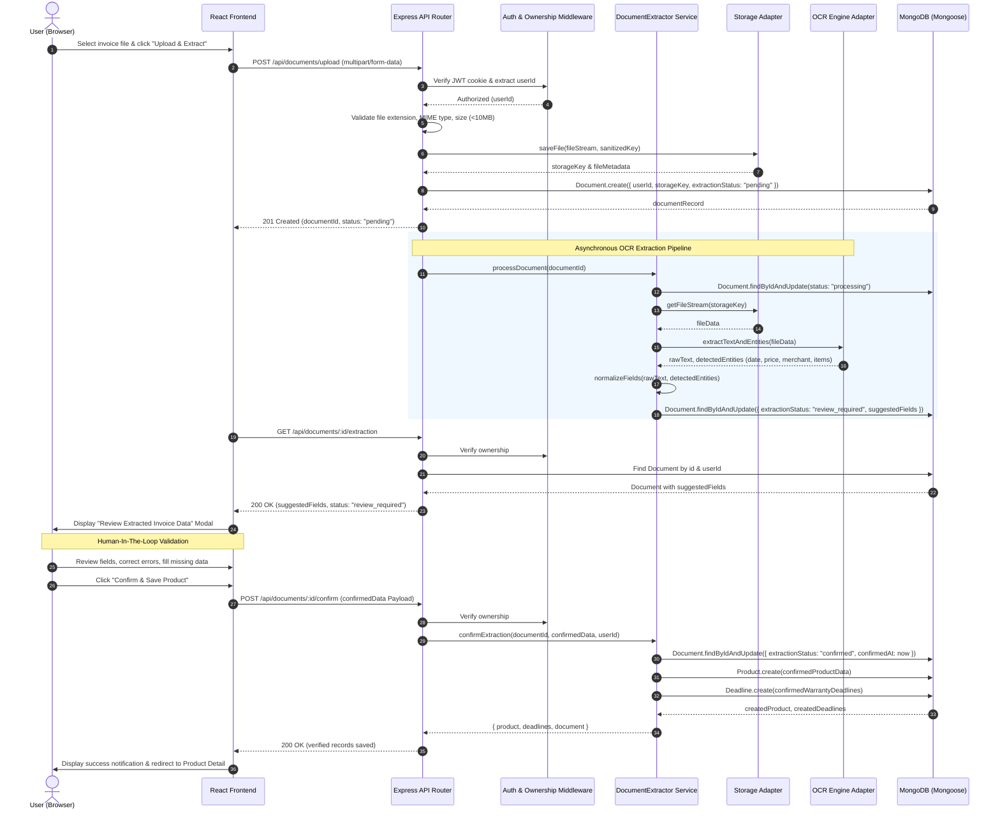

# ProofNest — Document Processing & OCR Pipeline

---

## 1. Document Management Scope

ProofNest manages all product-related paperwork, including:
- Official purchase receipts and retail tax invoices.
- Manufacturer warranty registration cards and extended warranty certificates.
- User manuals, technical specification PDFs, and assembly schematics.
- Repair service receipts, replacement part invoices, and diagnostic sheets.

---

## 2. Supported Formats, Size Limits & File Storage

| Attribute | Specification | Enforcement Mechanism |
| :--- | :--- | :--- |
| **Accepted Formats** | PDF (`application/pdf`), JPEG (`image/jpeg`), PNG (`image/png`), WEBP (`image/webp`) | Multer fileFilter + Magic byte inspection via `file-type` |
| **Maximum File Size** | 10 MB (10,485,760 bytes) | Multer `limits: { fileSize: 10485760 }` |
| **Storage Naming** | Unguessable UUID (e.g. `c7b2a19e-4e20-4a88-9ef1-bf910d540231.pdf`) | Prevents enumeration attacks and preserves privacy |
| **Directory Structure** | `uploads/documents/YYYY/MM/<uuid>.<ext>` | Avoids filesystem directory performance degradation |
| **Storage Providers** | Local filesystem (development) / S3-compatible bucket (production) | Handled by `StorageAdapter` interface |

---

## 3. The 10-Step Human-In-The-Loop Verification Sequence



### Detailed Sequence Breakdown:
1. **User Action:** The user selects a receipt file and clicks "Upload & Extract Invoice".
2. **Gateway Validation:** The backend validates extension, MIME type, and size.
3. **Encrypted Persistence:** The file is streamed to encrypted storage and assigned an unguessable UUID.
4. **Pending Document Record:** A `Document` entry is created with `extractionStatus: "pending"`.
5. **OCR Job Trigger:** The asynchronous extraction worker is invoked.
6. **Entity Extraction:** The OCR adapter processes pages, identifies invoice layout, text blocks, and key-value pairs.
7. **Field Normalization:** `DocumentExtractor.normalizeExtractedFields()` cleans up raw OCR text into ISO dates, numeric currency amounts, merchant names, and candidate product titles.
8. **Suggestion Assignment:** The `Document` record is updated with `extractionStatus: "review_required"` and `suggestedFields`.
9. **UI Side-by-Side Review:** The frontend renders an interactive review dialog showing the original invoice alongside editable suggestion inputs.
10. **Explicit Confirmation:** The user reviews each field, amends errors, and clicks "Confirm & Save". The frontend submits `POST /api/documents/:id/confirm`. Only then are the verified `Product` and `Deadline` records written to MongoDB.

---

## 4. Extraction Status State Machine

```
              ┌──────────────┐
              │   pending    │
              └──────┬───────┘
                     │ (Job starts)
                     ▼
              ┌──────────────┐
              │  processing  │
              └──────┬───────┘
                     │
        ┌────────────┴────────────┐
 (OCR Success)             (Unreadable/Corrupt)
        │                         │
        ▼                         ▼
 ┌──────────────┐          ┌──────────────┐
 │review_require│          │    failed    │
 └──────┬───────┘          └──────────────┘
        │
(User Confirms)
        │
        ▼
 ┌──────────────┐
 │  confirmed   │
 └──────────────┘
```

---

## 5. Normalized Field Mapping Schema

The OCR parser maps extracted entities into a consistent JSON dictionary:

```json
{
  "merchant": "Apple Fifth Avenue",
  "date": "2025-11-20T00:00:00.000Z",
  "totalAmount": 3499.00,
  "currency": "USD",
  "itemName": "MacBook Pro 16\"",
  "brand": "Apple",
  "model": "A2485",
  "serialNumber": "C02G1234MD6R",
  "warrantyPeriodMonths": 36
}
```

---

## 6. Adapter Interfaces

### 6.1 `OcrAdapter` Interface
```javascript
class OcrAdapter {
  /**
   * Processes a document stream or buffer and returns raw text plus candidate entities.
   * @param {Buffer|ReadableStream} fileBuffer
   * @param {string} mimeType
   * @returns {Promise<{ rawText: string, detectedEntities: object }>}
   */
  async extractTextAndEntities(fileBuffer, mimeType) {
    throw new Error('extractTextAndEntities() must be implemented by concrete adapter');
  }
}
```

### 6.2 Implementations
- `TesseractOcrAdapter`: Local offline OCR engine using Tesseract.js for development and testing without external API costs.
- `CloudOcrAdapter`: Production-ready adapter supporting Google Cloud Document AI or AWS Textract for high-accuracy invoice layout parsing.
